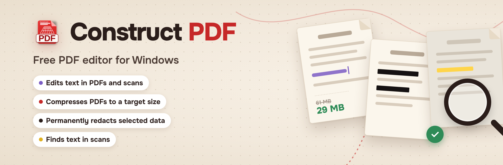
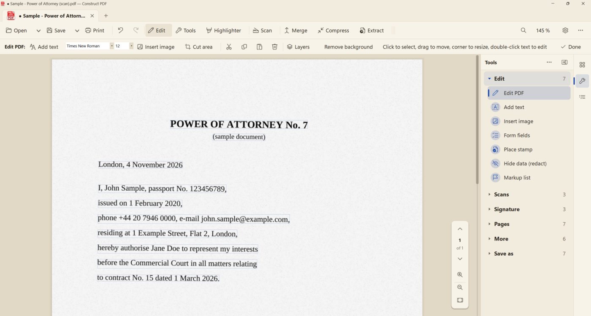

<p align="right"><b>English</b> · <a href="README.ru.md">Русский</a></p>

<p align="center"></p>

<p align="center">
<b>Free PDF editor for Windows.</b> Edit PDFs and scanned pages, compress to a target size, redact selected content.<br>
No ads, no sign-up, no watermarks. Works offline: your documents stay on your computer.
</p>

<p align="center">
<a href="https://constructpdf.ru/en/download.html"><b>Download for Windows</b></a> ·
<a href="https://constructpdf.online/en/">Try online</a> ·
<a href="https://github.com/DmitroRussia/construct-pdf/releases/latest">GitHub mirror</a>
</p>

<p align="center">
<a href="https://github.com/DmitroRussia/construct-pdf/releases/latest"></a>

</p>

<p align="center"></p>
<p align="center"><sub>Edit mode on a scanned page: every recognized line can be edited. On the right — the Tools panel. Example document with fictional data.</sub></p>

---

## Main features

| Feature | What it does |
|---|---|
| **Edits text in PDFs and scans** | Edit existing text in PDFs and in scanned pages, with automatic font matching. |
| **Compresses to a target size** | Enter the size in megabytes and the app picks the compression to fit an upload limit. Check the result quality before sending. |
| **Redacts selected content** | Selected text and the image under the box are removed from the page, not just covered: they cannot be found or copied. A self-check runs after saving. Check document properties and bookmarks separately. |
| **Finds text in scans** | Russian and English OCR on your computer: scans become searchable and copyable, the text can be saved to Word. |

**Also:** merge, split, rotate, delete and extract pages · CryptoPro e-signature, drawn or image signature · PDF to Word, images to PDF and back.

## Download

| Platform | File | Download |
|---|---|---|
| Windows 7, 8.1, 10, 11 | Installer, about 18 MB | [constructpdf.ru](https://constructpdf.ru/en/download.html) · [GitHub mirror](https://github.com/DmitroRussia/construct-pdf/releases/latest) |
| Windows 7, 8.1, 10, 11 | Portable ZIP, runs without installation | [constructpdf.ru](https://constructpdf.ru/en/download.html) · [GitHub mirror](https://github.com/DmitroRussia/construct-pdf/releases/latest) |
| Linux x64 | Beta, `.tar.gz` — some Windows features are still being ported | [constructpdf.ru](https://constructpdf.ru/en/pdf-editor-linux.html) · [GitHub mirror](https://github.com/DmitroRussia/construct-pdf/releases/latest) |
| Web version | Works in a browser, no installation | [constructpdf.online](https://constructpdf.online/en/) |

The app checks for updates and offers to install a new version.

## Download safety

- The installer is **not yet code-signed**. Some antivirus engines flag this build; the developer considers these detections false positives and has submitted the file for review.
- [VirusTotal report for ConstructPDF-1.7-Setup.exe](https://www.virustotal.com/gui/file/449224ce1a3a748cd1a82ba9be3aa4f89edfb38f7ab740d36618acf5a98a5f87)
- SHA-256 checksums are listed in each release and in `SHA256SUMS.txt`. To check a downloaded file in PowerShell:

```powershell
Get-FileHash .\ConstructPDF-1.7-Setup.exe -Algorithm SHA256
```

A matching checksum confirms the file is the one published here; it is not a safety guarantee by itself.

## Limitations

- When redacting, check document properties and bookmarks separately.
- OCR supports Russian and English only.
- The Linux version is in beta.

## Feedback

- Bug or idea: open an [issue](https://github.com/DmitroRussia/construct-pdf/issues/new/choose). Please do not attach documents with real personal data.
- Security problem (for example, redacted data still readable): see [SECURITY.md](SECURITY.md).
- Email: **support@constructpdf.ru**

If the app is useful to you, you can support the project with a star.

## License

Freeware. The application source code is not published. This repository hosts documentation, downloads and issue tracking. Third-party components and their licenses are listed in a file in the program folder.

© 2026 DmitroRussia
