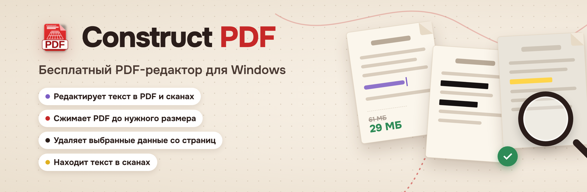
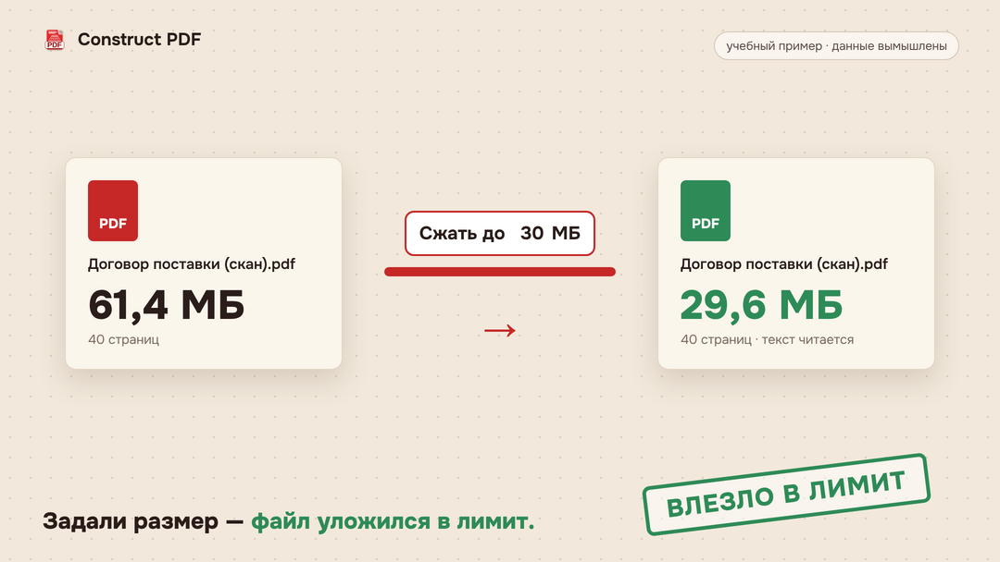
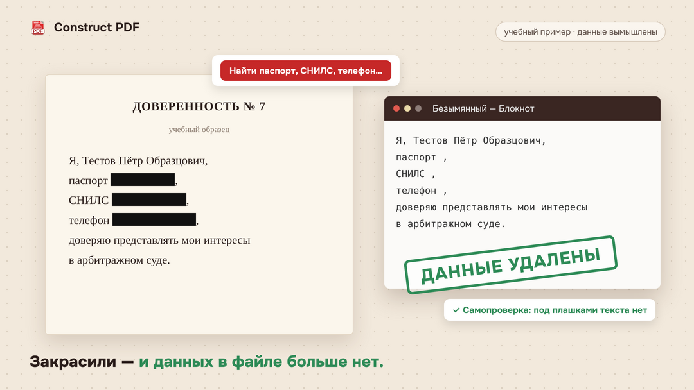
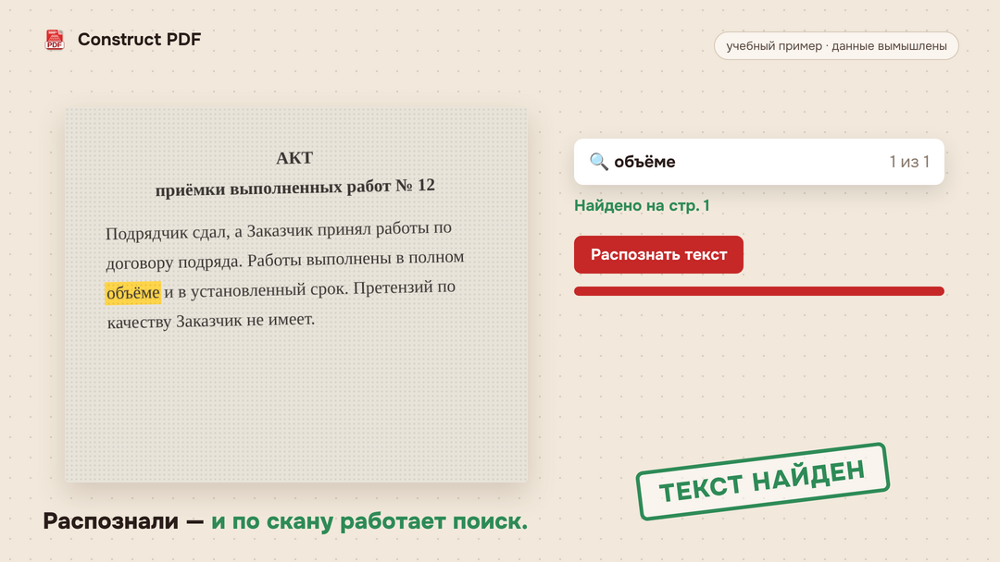

<b>Бесплатный PDF-редактор для Windows</b> — без рекламы, регистрации и водяных знаков. 
Работает без интернета, файлы никуда не уходят.

<a href="https://constructpdf.ru/skachat.html"><b>Скачать</b></a> ·
<a href="https://constructpdf.online">Версия в браузере</a> ·
<a href="https://constructpdf.ru">Сайт</a> ·
<a href="README.md">English</a>

---

## Что умеет

| Функция | Что делает |
|---|---|
| **Редактирует текст в PDF и сканах** | Главная функция: правка текста прямо в PDF и в сканах — с подбором похожего шрифта, как в обычном текстовом редакторе. |
| **Сжимает PDF до нужного размера** | Вводите нужный размер в мегабайтах — программа сама подбирает сжатие, чтобы файл уложился в лимит портала, а текст оставался читаемым. |
| **Удаляет личные данные без следа** | Паспорт, СНИЛС, телефон удаляются из файла, а не прячутся под прямоугольником: их не найти поиском и не скопировать. После сохранения программа сама проверяет, что под плашкой не осталось текста. |
| **Находит текст в сканах** | Русский и английский текст распознаётся прямо на компьютере: по скану работают поиск и копирование, текст можно сохранить в Word. |
| **Работает со страницами** | Объединить, разделить, повернуть, удалить, извлечь страницы. |
| **Подписывает документы** | Электронная подпись через КриптоПро, нарисованная или из картинки. |
| **Переводит в другие форматы** | PDF в Word, картинки в PDF и обратно. |

На картинках — учебные примеры, данные вымышлены.

## Системные требования

- Windows 7, 8.1, 10, 11
- Установщик около 18 МБ или ZIP без установки
- Linux — бета-версия, на сайте

## Скачать

- **[Последняя версия на сайте](https://constructpdf.ru/skachat.html)** — установщик и ZIP
- Без установки, в браузере: **[constructpdf.online](https://constructpdf.online)**

Программа сама проверяет обновления и предлагает установить новую версию.

## Ограничения

- При закрашивании свойства документа и закладки нужно проверять отдельно.
- Распознавание — только русский и английский.
- Версия для Linux пока в бете.

## Ошибки и пожелания

Пишите в [Issues](../../issues) или на **support@constructpdf.ru**.

## Лицензия

Construct PDF — бесплатная программа (freeware) с закрытым исходным кодом. Этот репозиторий — страница проекта: описание, ссылки на скачивание и обратная связь. Сторонние компоненты и их лицензии перечислены в файле «Лицензии сторонних компонентов» в папке программы.

© 2026 DmitroRussia
